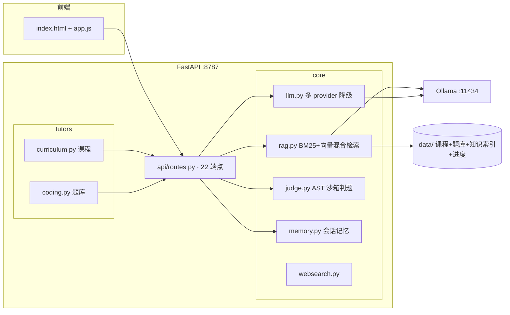

# llm-tutor-agent — LLM 学习助手 Agent

[](https://github.com/HUG-thefuture/llm-tutor-agent/actions/workflows/ci.yml)


一个**可运行的 LLM 应用开发学习平台**：20 门中文课程（环境→Python→LLM API→Prompt→LangChain/LangGraph→RAG→Agent→FastAPI 全栈→部署→测试质量）+
力扣题库练习 + 自主开发任务，由多 provider 大模型驱动，检索与判题全部本地化。

> 设计取向：**教学与工程同构**——`backend/core/rag.py` 既是在用的知识库，也是一份"可运行的 RAG 教材"
> （手写 BM25 + 向量混合检索，与课程里的 LangChain/FAISS 版本两相对照）。

## 核心特性

- **混合检索 RAG**：手写 BM25（中文 bigram 分词）+ Ollama 本地 embedding（nomic-embed-text 等），
  归一化融合重排；无 embedding 模型时静默退化为纯 BM25，开箱可跑
- **检索质量可量化**：内置 21 条中文问法评估集，`hit@k / MRR` 离线评估 + CI 回归门（见下方实测）
- **多 provider 降级**：DeepSeek / 智谱 / 百炼 OpenAI 兼容接口按配置自动降级；只有本地 Ollama 也能完整运行
- **AST 沙箱判题**：力扣题解子进程运行 + 内置用例判定，无需在线判题服务
- **完整 API 面**：22 个端点覆盖 对话 / 课程学习 / 力扣（运行/提示/复盘/讲解）/ 开发任务 / 知识库重建上传 / 配置自检
- **前后端一体**：FastAPI + 原生 JS 前端单页，`start.bat` 双击即用

## 检索质量实测（evals/eval_retrieval.py，246 chunks / 21 条评估集）

| 指标 | 纯 BM25 | 混合检索（BM25 + nomic-embed-text） | 增益 |
|---|---|---|---|
| hit@1 | 71.4% | **76.2%** | +4.8pp |
| hit@3 | 81.0% | **95.2%** | +14.2pp |
| hit@5 | 90.5% | **100%** | +9.5pp |
| MRR | 0.789 | **0.845** | +0.056 |

复现：`python evals/eval_retrieval.py --save`（纯 BM25 零依赖；装有 Ollama embedding 模型时自动加测对照）。
阈值已固化进 CI（`tests/test_retrieval_eval.py`）：检索实现退化到基线以下会拦截合并。

## 快速开始

```bash
pip install -r requirements.txt
# 可选：复制 .env.example 为 .env 填外部模型 Key；不填则用本地 Ollama
# 可选：ollama pull nomic-embed-text   # 启用混合检索

:: Windows 一键启动（浏览器自动打开 http://127.0.0.1:8787）
start.bat
:: 或手动
python -m uvicorn backend.main:app --host 127.0.0.1 --port 8787
```

## 架构



## 测试与评估

```bash
python -m pytest -q                       # 单元测试（无外部服务依赖，自动跳过集成项）
python evals/eval_retrieval.py --save     # 检索质量评估 + 报告落盘
```

## 目录结构

```
├── backend/
│   ├── main.py            # FastAPI 装配：配置/LLM/KB/课程/题库 → 路由 + 前端
│   ├── api/routes.py      # 22 个 REST 端点
│   ├── core/              # rag / llm / judge / memory / websearch / staticcheck / config
│   └── tutors/            # curriculum 课程装配 / coding 题库
├── frontend/              # 原生 JS 单页（无构建步骤）
├── data/curriculum/       # 20 门中文课程（Markdown，frontmatter 元数据）
├── data/leetcode/         # 力扣题库（内置可判题用例）
├── evals/                 # 检索质量评估脚本 + 报告
├── tests/                 # pytest 单测（含检索质量回归门）
├── prompts/ skills/       # 系统提示词 / 开发 Agent 技能矩阵
├── config.yaml            # provider / RAG / Agent 参数（模型 Key 走 .env，不入库）
└── start.bat              # Windows 双击启动
```

## 安全说明

外部模型 Key 一律走 `.env` 或系统环境变量（模板见 `.env.example`），`.env` 已被 `.gitignore`
忽略；`config.yaml` 仅含非敏感参数。克隆后无需任何凭据即可运行（本地 Ollama 模式）。
